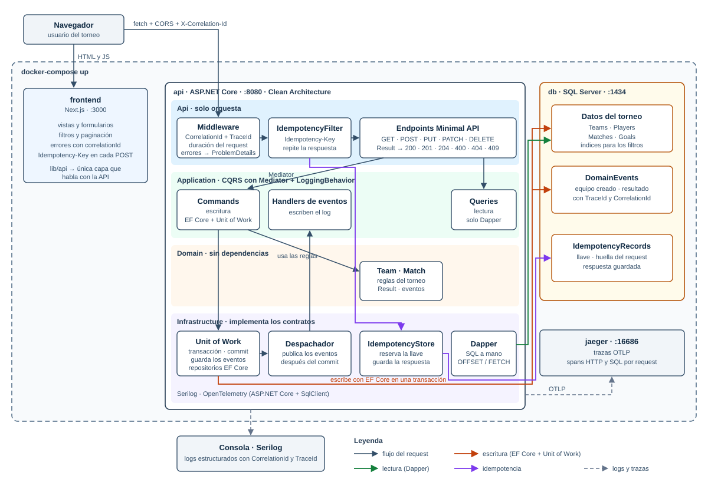

# Mundialito Corporativo

Sistema para controlar un torneo de fútbol corporativo: equipos, integrantes, calendario de partidos, resultados, tabla de posiciones y goleadores.

API en .NET 10 con Clean Architecture y CQRS (EF Core para escribir, Dapper para leer), Unit of Work, Result pattern, REST con idempotencia, observabilidad con Serilog y OpenTelemetry, frontend en Next.js y todo levantado con Docker.



---

## Levantarlo

Requisito: Docker.

```bash
docker-compose up
```

La primera vez construye las imágenes y tarda unos minutos. Al arrancar, la API crea la base de datos y carga datos de ejemplo, así que la tabla de posiciones se puede ver de inmediato.

| Servicio | URL |
|---|---|
| Frontend | http://localhost:3000 |
| API: documentación interactiva (Scalar) | http://localhost:8080/scalar/v1 |
| API: especificación OpenAPI | http://localhost:8080/openapi/v1.json |
| API: salud | http://localhost:8080/health |
| Jaeger: trazas | http://localhost:16686 |
| SQL Server | `localhost,1434` · usuario `sa` |

Para empezar desde cero (borra la base y vuelve a cargar los datos de ejemplo):

```bash
docker-compose down -v
```

La contraseña de SQL Server se puede definir con la variable `DB_PASSWORD`; si no, se usa la de desarrollo del `docker-compose.yml`. SQL Server se publica en el 1434 para no chocar con una instancia local en el 1433.

## Probarlo

- **Frontend:** tabla, goleadores, partidos (con alta y registro de resultados) y equipos (con alta, edición, baja e integrantes).
- **Scalar:** todos los endpoints con sus parámetros, para probarlos desde el navegador.
- **Postman:** importar `postman/Mundialito.postman_collection.json` y `postman/Mundialito.postman_environment.json`, elegir el entorno *Mundialito · Docker local* y correr la colección completa (*Run collection*). Son 40 peticiones con 133 verificaciones, organizadas en carpetas: equipos, jugadores, partidos, tabla, idempotencia y errores. Cada carpeta guarda los Ids que usan las siguientes. También corre por consola:

  ```bash
  npx newman run postman/Mundialito.postman_collection.json -e postman/Mundialito.postman_environment.json
  ```

---

## Arquitectura

```
src/
  Mundialito.Domain/          entidades, reglas del torneo, eventos, Result. Sin dependencias
  Mundialito.Application/     commands, queries, contratos (interfaces), behaviors
  Mundialito.Infrastructure/  EF Core, Dapper, Unit of Work, idempotencia, seed
  Mundialito.Api/             endpoints, middleware, observabilidad, composition root
tests/
  Mundialito.UnitTests/         pruebas del dominio, Result, idempotencia y Unit of Work
  Mundialito.IntegrationTests/  API completa contra SQL Server con Testcontainers
frontend/                     Next.js
postman/                      colección y entorno
docs/                         diagramas
```

Las dependencias apuntan hacia adentro: Domain no referencia nada, Application solo a Domain, Infrastructure implementa los contratos de Application y la Api solo orquesta y conecta las capas en `Program.cs`. El detalle, con el recorrido de un request, está en [docs/arquitectura.md](docs/arquitectura.md).

### Decisiones técnicas

| Decisión | Motivo |
|---|---|
| .NET 10 (LTS) y SQL Server | Versión con soporte extendido; SQL Server corre en Docker |
| CQRS con Mediator (martinothamar) | MIT y con el código generado al compilar; MediatR es comercial desde la v13 |
| Commands con EF Core; queries con Dapper | EF lleva el control de cambios para escribir; Dapper da SQL a medida y paginación en la base para leer |
| Un repositorio por agregado (`Team` con sus `Player`, `Match` con sus `Goal`) | Cada agregado expone solo lo que sus reglas permiten; no hay `IRepository<T>` genérico |
| Ids `Guid.CreateVersion7()` | El dominio crea el Id antes de guardar y, al ser ordenados por tiempo, no fragmentan los índices |
| Result pattern con tipo de error | Sin excepciones para el flujo de negocio; un solo punto traduce el tipo a 400, 404 o 409 |
| Errores en ProblemDetails (RFC 9457) | Formato estándar, con `errorCode`, `correlationId` y `traceId` |
| Minimal APIs agrupadas por recurso | Endpoints delgados: request → command o query → Result → HTTP |

### Unit of Work

- Es el único que guarda: `AppDbContext` es `internal` a Infrastructure, así que nadie más puede llamar a `SaveChanges`.
- Repositorios, Unit of Work y handlers comparten el mismo `DbContext` por request (Scoped): los cambios de varios repositorios se confirman en una sola transacción.
- Una violación de índice único al confirmar se traduce a un `Result` de conflicto (409).
- Los eventos de dominio se guardan en `DomainEvents` dentro de la misma transacción y se publican a sus handlers después del commit.

---

## API

Todas las respuestas de error usan ProblemDetails:

```json
{
  "title": "Team.NameAlreadyExists",
  "status": 409,
  "detail": "Ya existe un equipo llamado 'Tecnología'.",
  "errorCode": "Team.NameAlreadyExists",
  "correlationId": "3f6aff33767744f88b34d509f857c60b",
  "traceId": "00-731579d67dcb0e31f23c984d51f9e8ac-c758ffeb413d1a43-01"
}
```

| Método | Ruta | Respuesta |
|---|---|---|
| GET | `/api/teams` | 200, paginado |
| GET | `/api/teams/{id}` | 200 · 404 |
| POST | `/api/teams` | 201 + `Location` · 400 · 409 |
| PUT | `/api/teams/{id}` | 204 · 400 · 404 · 409 |
| PATCH | `/api/teams/{id}` | 204 · 400 · 404 · 409 |
| DELETE | `/api/teams/{id}` | 204 (idempotente) · 409 si tiene partidos |
| GET | `/api/teams/{id}/players` | 200, paginado · 404 |
| POST | `/api/teams/{id}/players` | 201 · 400 · 404 · 409 |
| GET | `/api/matches` | 200, paginado |
| GET | `/api/matches/{id}` | 200 con sus goles · 404 |
| POST | `/api/matches` | 201 · 400 · 404 |
| POST | `/api/matches/{id}/result` | 200 · 400 · 404 · 409 |
| GET | `/api/standings` | 200, paginado |
| GET | `/api/top-scorers` | 200, paginado |
| GET | `/health` | 200 |

### Filtros, orden y paginación

Todos los listados aceptan `pageNumber` (por defecto 1), `pageSize` (por defecto 10, máximo 100), `sortBy` y `sortDirection` (`asc` / `desc`), y responden:

```json
{ "data": [], "pageNumber": 1, "pageSize": 10, "totalRecords": 50, "totalPages": 5 }
```

| Recurso | `sortBy` (el primero es el orden por defecto) | Filtros |
|---|---|---|
| Equipos | `name`, `city`, `createdAt` | `name`, `city` (contiene) |
| Jugadores | `number`, `name`, `position` | `name` (nombre o apellido), `position` |
| Partidos | `date`, `status` | `from`, `to`, `teamId` (local o visitante), `status` (`Scheduled` / `Played`) |
| Tabla | `position`, `points`, `goalsFor`, `name` | — |
| Goleadores | `goals` (descendente por defecto), `name` | `teamId` |

- El conteo y la página salen en un solo viaje a la base, con `OFFSET / FETCH`; nunca se trae todo a memoria.
- `sortBy` usa una lista blanca que se traduce a columnas fijas, y los filtros van como parámetros: no se concatena texto del cliente en el SQL.
- Cada orden lleva un desempate por Id (o por nombre), para que la paginación sea estable.

### Idempotencia

Los `POST` exigen el header `Idempotency-Key` (hasta 100 caracteres).

| Caso | Respuesta |
|---|---|
| Sin llave | 400 `Idempotency.KeyRequired` |
| Llave nueva | Se ejecuta y se guarda la respuesta |
| Misma llave y mismo body | La respuesta original, sin ejecutar otra vez, con `Idempotent-Replayed: true` |
| Misma llave y otro body | 409 `Idempotency.KeyReused` |
| Misma llave mientras la primera sigue en curso | 409 `Idempotency.InProgress` |
| La primera petición falló con 5xx | La llave se libera para poder reintentar |

- La llave es la llave primaria de `IdempotencyRecords`: con peticiones simultáneas, la base solo deja reservarla a una.
- Se compara una huella SHA-256 del método, la ruta y el body para detectar una llave reutilizada con otra petición.
- Las respuestas 4xx también se guardan: repetir una petición inválida devuelve el mismo error.
- PUT, PATCH y DELETE ya son idempotentes por naturaleza. DELETE responde 204 aunque el recurso ya no exista.

---

## Reglas del torneo y criterios propios

- **Puntos:** victoria 3, empate 1, derrota 0 (constantes en `TournamentRules`, que también usa el SQL de la tabla).
- **Orden de la tabla:** puntos, diferencia de gol, goles a favor y nombre como desempate final. `position` siempre es el puesto oficial, aunque se ordene por otro campo.
- La tabla y los goleadores **se calculan al consultar**, así que siempre están al día con los resultados.
- Los goles registrados **deben cuadrar** con el marcador.
- El equipo de cada gol lo toma el servidor del jugador; el cliente solo manda jugador y minuto.
- Un resultado no se modifica una vez registrado (409). Un partido jugado no se reprograma.
- Minuto válido de un gol: 1 a 120. Estados de un partido: `Scheduled` y `Played`.
- Un equipo no juega contra sí mismo. Los dos equipos de un partido deben existir.
- Nombre de equipo único, sin distinguir mayúsculas. Dorsal único por equipo, de 1 a 99.
- No se elimina un equipo con partidos (409).
- **PATCH:** un campo en `null` significa «no tocar». Para borrar la ciudad se usa PUT.
- Todas las fechas se guardan en UTC. En los filtros, una fecha sin zona horaria se toma como UTC.
- **No se modelan autogoles:** todo gol cuenta para el equipo del jugador.

### Datos de ejemplo

Al arrancar, si no hay equipos, se cargan 4 equipos (departamentos de una empresa), 5 jugadores por equipo y un todos contra todos de 6 partidos, 3 de ellos con resultado. El seed pasa por el dominio y el Unit of Work, así que cumple las mismas reglas que la API y levanta sus eventos. Las fechas son relativas al día de arranque: 3 partidos en el pasado y 3 en el futuro.

---

## Observabilidad

- **Logs estructurados** con Serilog detrás de `ILogger`: Application y Domain no dependen de Serilog. No se loggean bodies ni el contenido de los commands.
- **Cada request** lleva un `CorrelationId` (del header `X-Correlation-Id` si es válido, o generado) y el `TraceId` de OpenTelemetry. Los dos van en todos sus logs y en los headers de respuesta.
- **Duración** de cada request (middleware) y de cada command o query (pipeline behavior de Mediator).
- **Niveles:** `Debug` para el detalle interno, `Information` para operaciones exitosas, `Warning` para errores de negocio y respuestas 4xx, `Error` para fallos no controlados y respuestas 5xx. Los registros internos de EF Core sobre comandos fallidos están silenciados: un registro duplicado queda como `Warning` en el Unit of Work (es un 409 esperado) y los errores reales llegan como `Error` al manejador global.
- **Errores no controlados:** 500 con un mensaje genérico y el `correlationId`; el detalle queda solo en el log.
- **Trazas:** OpenTelemetry exporta por OTLP a Jaeger los spans de cada request y de cada consulta SQL, tanto de EF Core como de Dapper. Las trazas se pueden buscar por la etiqueta `correlation.id`.
- **Eventos de dominio** (equipo creado, resultado registrado): se loggean y se guardan en `DomainEvents` con el `TraceId` y el `CorrelationId` del request que los produjo.

Ejemplo de logs de un request:

```
[INF] HTTP POST /api/teams respondió 201 en 52.4 ms {CorrelationId=demo-123, TraceId=73b224d9...}
[INF] CreateTeamCommand terminó en 14.8 ms {CorrelationId=demo-123, TraceId=73b224d9...}
[INF] Equipo creado: 01a1... Halcones (EventId ...) {CorrelationId=demo-123, TraceId=73b224d9...}
```

---

## Pruebas

```bash
dotnet test
```

39 pruebas unitarias y 7 de integración. Las de integración necesitan Docker abierto.

### Unitarias

| Área | Qué cubren |
|---|---|
| Tabla de posiciones | Orden por puntos, diferencia de gol y goles a favor; desempate por nombre; equipos sin partidos; partidos sin jugar |
| Puntos y diferencia de gol | Victoria, empate, derrota y su acumulación |
| Result pattern | Success, Failure, código y mensaje, valor, conversiones implícitas, tipos de error |
| Partido | Equipo contra sí mismo, resultado repetido, goles que no cuadran, evento de dominio |
| Idempotencia | Llave obligatoria, respuesta repetida sin ejecutar otra vez, llave reutilizada (409), liberación tras un 500 |
| Unit of Work | Nada se guarda antes del commit, varios repositorios en un commit, eventos guardados y publicados después del commit, atomicidad si el commit falla |

Las del Unit of Work usan SQLite en memoria porque, a diferencia del proveedor InMemory de EF, soporta transacciones reales.

### Integración

Levantan la API completa con `WebApplicationFactory` contra un SQL Server real que crea **Testcontainers** en Docker para cada corrida. La API migra y carga el seed al arrancar, igual que con `docker-compose`.

| Prueba | Qué demuestra |
|---|---|
| La tabla del SQL coincide con el calculador del dominio | El SQL de Dapper y `StandingsCalculator` dan la misma tabla sobre los mismos datos |
| Los goleadores coinciden con los goles guardados | La consulta de goleadores cuenta bien |
| La paginación sale de la base | `OFFSET / FETCH`, totales y puesto oficial en la página 2 |
| Repetir un POST con la misma llave | Idempotencia de punta a punta, contando en la base |
| Mismo nombre al mismo tiempo | 5 peticiones simultáneas: un 201, el resto 409 por el índice único, un solo equipo guardado |
| Registrar un resultado | Actualiza la tabla y guarda el evento con el `CorrelationId` y el `TraceId` del request |
| Error de negocio | ProblemDetails con `errorCode` y `correlationId` |

```bash
dotnet test tests/Mundialito.UnitTests          # solo unitarias, sin Docker
dotnet test tests/Mundialito.IntegrationTests   # solo integración
```

---

## Desarrollo sin Docker

```bash
docker run -d --name mundialito-sql -e ACCEPT_EULA=Y -e "MSSQL_SA_PASSWORD=Mundialito#Dev2026" -p 1433:1433 mcr.microsoft.com/mssql/server:2022-latest
dotnet run --project src/Mundialito.Api
```

La API aplica las migraciones al arrancar. Para el frontend, crear `frontend/.env.local` con `NEXT_PUBLIC_API_URL` apuntando al puerto de la API y correr `npm install` y `npm run dev` dentro de `frontend/`.

---

## Limitaciones y mejoras futuras

- **Patrón Outbox completo:** los eventos ya se guardan en la misma transacción; faltaría un proceso que los publique desde la tabla con reintentos.
- **Llaves de idempotencia:** no expiran; se borrarían las de más de 24 horas con un proceso programado. Si el proceso se cae entre el commit del caso de uso y el guardado de la respuesta, la llave queda en curso.
- **Migraciones al arrancar:** adecuado para una instancia; con varias réplicas se correrían en el pipeline de despliegue.
- **Autogoles** y otros estados de partido (suspendido, cancelado).
- **Seguridad:** autenticación y autorización; la documentación de la API se publicaría solo en ambientes internos.
- **Logs centralizados** (Seq o Elasticsearch) y métricas.
- Con un volumen grande de partidos, la tabla de posiciones se podría materializar y actualizar con el evento de resultado registrado.
