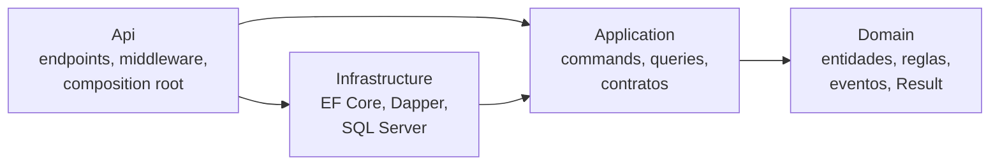
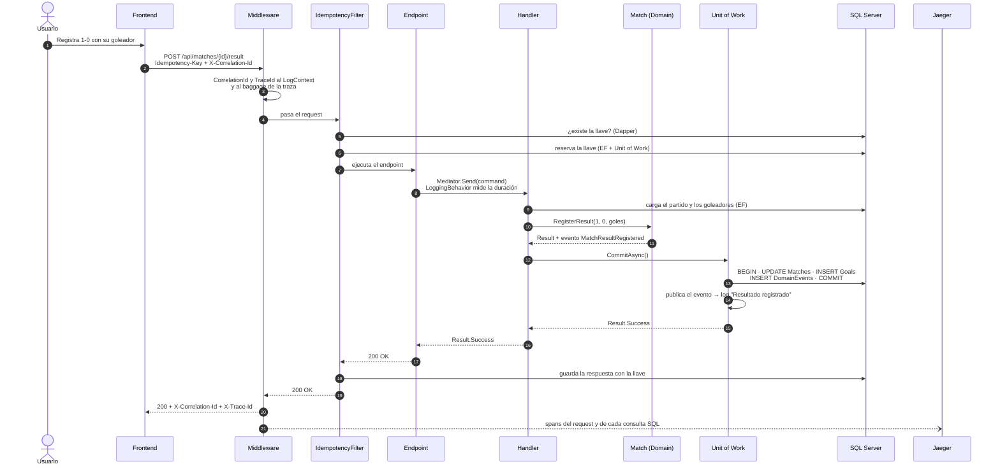

# Arquitectura

## 1. Vista general

Los cuatro contenedores de `docker-compose`, las capas de la API y por dónde pasa cada cosa: escritura con EF Core y Unit of Work, lectura con Dapper, idempotencia, eventos, logs y trazas.

## 2. Dependencias entre capas

Las flechas apuntan hacia adentro: Domain no conoce a nadie y la Api solo conecta las piezas.

## 3. Recorrido de un request (trace flow)

Registrar un resultado de punta a punta. El `TraceId` y el `CorrelationId` acompañan cada paso: van en todos los logs, en la traza de Jaeger y en el evento guardado.

Si el mismo request se repite con la misma `Idempotency-Key`, el filtro encuentra la llave en el paso 5, devuelve la respuesta guardada y el endpoint no se ejecuta.
